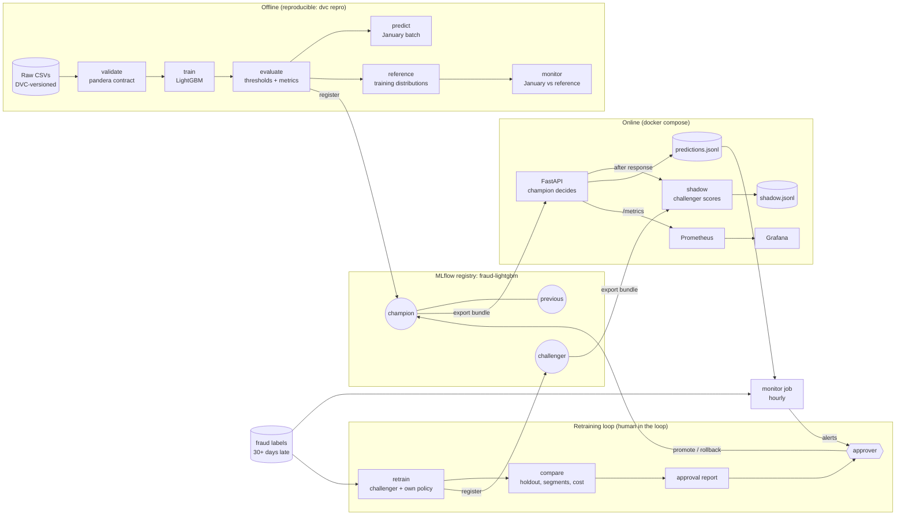

# Architecture

How the fraud-scoring system is built, how a model moves from data to production and back, and what would change at real scale.
Companion documents: [monitoring runbook](monitoring.md) and [model card](model_card.md).

## 1. The system on one page

| Layer | What | Where |
|---|---|---|
| Data | Labelled 2025 history, January 2026 to score. Versioned with DVC; validated by a pandera contract. | `data/raw/*.dvc`, `src/fraud_detection/data.py` |
| Features | One function, `make_features`, for training, batch and API. Its category vocabulary is saved with each model. | `features.py` |
| Training | Evaluation model (early stopping) → final model with recent data weighted. | `train.py`, `params.yaml` |
| Policy | Thresholds turn a score into approve / review / block. They are chosen on validation data by cost, and stored next to the model. | `evaluate.py`, `policy.py` |
| Registry | MLflow versions; aliases `champion`, `challenger`, `previous`. Each version carries a deploy bundle. | `tracking.py`, `promote.py` |
| Serving | FastAPI + Uvicorn in Docker, non-root. It reads the bundle exported from the registry. | `api/`, `Dockerfile`, `docker-compose.yml` |
| Monitoring | Prometheus metrics, a Grafana dashboard, an hourly drift and performance job, and a heartbeat. | `api/metrics.py`, `monitoring.py`, `monitoring/` |
| Retraining | Challenger with its own thresholds, then comparison, then approval report, then shadow, then promotion. | `retrain.py`, `compare.py`, `report.py`, `promote.py` |
| Quality | 124 tests, ruff, pre-commit, GitHub Actions (lint, tests, Docker smoke test). | `tests/`, `.github/workflows/ci.yml` |

## 2. Life of a model

1. **Train (offline, reproducible).** `dvc repro` runs six stages. Each one runs only if its code, data or parameters changed. The model's `metadata.json` records its git commit and the DVC hash of the training data, so every prediction can be traced back.
2. **Register.** The `evaluate` stage registers the final model in MLflow. `promote init` gives it the `champion` alias and exports its bundle (`final_model.txt`, `metadata.json`, `policy.json`) to `deploy/champion`.
3. **Serve.** The API loads the bundle once at startup and refuses to start without it. It answers in about 20 ms and logs every prediction.
4. **Watch.**
   - Prometheus: traffic, errors, latency, block rate and score percentiles in real time.
   - The hourly job: PSI per feature, score drift, segment rates.
   - Performance, once labels are 30 days old.
5. **Retrain.** When monitoring fires, or on a schedule, `retrain --as-of <date>` trains a **challenger** on matured labels.
   - Its windows are training, then validation, then a holdout that neither model ever trained on.
   - It gets **its own** thresholds, chosen by cost within a customer-impact budget.
6. **Compare.** `compare` scores the champion and the challenger on the holdout, each at its own thresholds. It checks:
   - PR-AUC gain, with a bootstrap interval;
   - honest customers blocked;
   - business cost;
   - every segment.
   It refuses a champion that has seen the holdout.
7. **Approve.** `report` writes a one-page Markdown decision with the judgment calls the rules can't make: review-queue workload, segments still weak, a binding budget. A person approves.
8. **Shadow.** `promote register` registers the challenger and exports it to `deploy/challenger`. The API scores a sample of live traffic with it **after** answering, and logs both decisions. `monitoring shadow` summarises agreement.
9. **Promote or roll back.** `promote --approved-by <name>` moves aliases: champion becomes previous, and challenger becomes champion. Approver, time and any override are recorded as registry tags. `rollback --reason` swaps back. Both re-export the bundle, followed by an API restart.

**Ship what you tested.** The promoted bundle is the exact model and thresholds that were evaluated and approved. Nothing is refit at promotion.

## 3. Key design decisions

| Decision | Why | Trade-off |
|---|---|---|
| Time-based splits everywhere | Fraud drifts; random splits leak the future and flatter the model. | Fewer rows for the most recent period. |
| Thresholds are part of the model release | A new model has a new score scale. The Dec-2025 challenger's cost-optimal threshold moved from 0.28 to 0.02. | Every release needs a policy review. |
| Cost-optimal threshold **within a customer-impact budget** | Pure cost minimisation (R$ 10 per false block) would block 6.7% of honest customers. The budget caps it at the champion's level + 0.5 pts. | Gives up part of the fraud savings; the budget is a business parameter. |
| Category vocabulary saved with the model | Codes must not depend on the batch; unseen values become "unknown", never a wrong code. | New cities are scored as unknown until retraining (monitored). |
| One fitting and one policy function for champion and challenger | Challenger and champion must differ only in data, never in procedure. | None; refactors were verified byte-identical. |
| Labels used only after 30 days | Recent transactions look clean only because fraud is reported late. | Concept drift is detected 31 days late (drift drill). |
| Registry aliases instead of copying files | One answer to "what is in production"; rollback is a pointer move. | Needs a restart to load new files (no hot reload). |
| Shadow after the response, sampled | The challenger can never change or delay an answer. | In one process it still competes for CPU. Measured: shadowing 100% of requests halved throughput, so it is sampled (20%). |
| Fail fast on the champion, fail soft on the shadow | A broken champion must stop the service; a broken challenger must not. | |
| Metrics with few fixed labels; detail in logs | High-cardinality labels overwhelm Prometheus. | Per-merchant questions need the batch job. |

## 4. Numbers that matter

| | Value |
|---|---|
| Test month (Dec 2025) PR-AUC / ROC-AUC | 0.618 / 0.941 (rule baseline 0.310) |
| Recall / precision at the block threshold 0.28 | 63% / 59%; 5.7% of transactions blocked |
| API latency, single request (Docker, 1 worker) | p50 ≈ 20 ms, p99 ≈ 45 ms; budget for real-time payments ≈ 700 ms |
| Throughput, 1 worker | ≈ 45–50 req/s single; ≈ 3,000 tx/s in batches of 100 |
| Concept-drift detection delay (drift drill) | 31 days = label maturity |
| Dec-2025 challenger vs champion (holdout Dec 18–31) | PR-AUC 0.624 → 0.682; recall 61% → 64%; honest customers blocked 2.4% → 2.7%; promote |

## 5. What would change at real scale

| Here | At scale (hundreds of millions of events per day) |
|---|---|
| Features computed from the request | A **feature store** with online/offline parity, and **velocity features** (transactions per card in the last hour), the biggest missing signal. |
| One API container, one worker | Kubernetes Deployment with autoscaling replicas; Prometheus service discovery; possibly a Python model **sidecar** next to the service that owns the payment flow. |
| Shadow inside the API process | Shadow as a **separate consumer** of a copy of the request stream (Kafka), with zero impact on serving. |
| Labels after 30 days | Early, weaker labels: analyst review outcomes and customer disputes within hours, to shorten detection of concept drift. |
| Dashboard colours | Prometheus alert rules + Alertmanager routing to on-call, with the runbook linked from each alert. |
| Batch monitor run by hand / cron | A scheduled job (Airflow or Kubernetes CronJob) with its heartbeat alert. |
| Local MLflow with SQLite | A shared tracking server, an object-store artifact store (S3/MinIO), and access control on promotion. |
| Model only | **Rules and model in parallel**: rules for known patterns and fast reaction (e.g. the night e-commerce fraud the Dec-2025 challenger still misses), the model for the rest. |
| Uncalibrated scores | Calibrated scores (isotonic), so thresholds and dashboards read as probabilities. |
